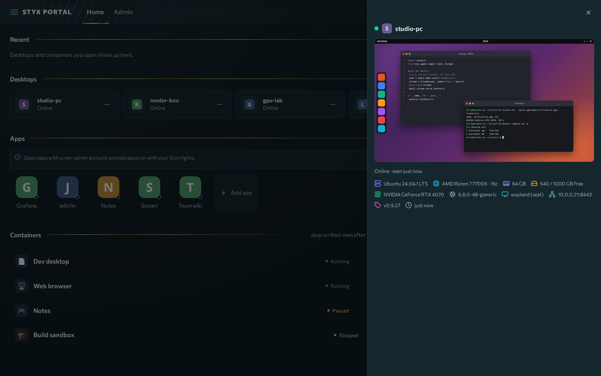

# Workstations

A **workstation** is a physical (or virtual) Linux machine that an admin enrolled in Styx. You stream its desktop to your browser, with audio, clipboard and file transfer.

**Prerequisites:** a signed-in account that an admin granted access to the workstation.

## Connect

1. On **Home**, find the workstation in **Desktops**. Tiles show a live preview and a status: **Online**, **Offline**, **Pending**, **Revoked**, or who is using it (**Connected (you)**, **In use by ...**).
2. Click **Connect** on an online tile (**Resume** if you already have the seat). The stream opens at `/w/<name>/`, in a new tab or this tab as set by the **Opening** preference in the account menu. The **⋯** menu has **Details**.
3. If you get a 401 you are not signed in; a 403 means you are not assigned to that workstation. Ask an admin.

!!! note "Seats belong to one user"
    Another user cannot open your live seat by URL. They must use **Connect with takeover**, which grants a 60-second window.

### What happens when you connect

## The stream panel

The Selkies sidebar controls the stream:

- **Resolution:** presets or a manual size. The seat resizes in place to match your browser window; anything below 640×480 is clamped and the maximum is 4096×2304.
- **UI scaling / HiDPI:** switch between GNOME scale 1 and 2 without restarting the stream. Turning **HiDPI off** (CSS pixels) streams a smaller frame on large retina windows and cuts encode cost.
- **Bitrate:** you may lower it; the admin's value is the ceiling and the floor is 1000 kbps.
- **Framerate, quality, Gaming mode, Sharpen static screen, Full colour (4:4:4):** admin values are the starting defaults; you can change them for your session.
- **Transport (WebRTC or WebSockets):** the admin's setting is the default. Switching in the sidebar overrides it for your browser, and the choice survives stream restarts such as a resize or entering Gaming mode. If the relay budget is used up the stream stays on WebSockets.
- **Ownership:** the connected controller owns the seat size. A second viewer takes the seat only when the first leaves; shared viewers (`#shared` links) watch at the controller's size. Sharing links work only for people signed in to the portal.

Admin changes apply as soon as nobody is connected (within about a second of the last viewer leaving), so they never kick an active session. Idle-timeout changes apply at once. The dialog says "Applies when no one is connected to this workstation."

## Clipboard, files, audio

| Feature | How it works |
|---|---|
| **Audio** | Automatic. In seat mode audio is isolated into a dedicated sink, so nothing plays from the machine's physical speakers. Audio adds roughly 100–250 ms of latency; turn it off for competitive play. |
| **Clipboard** | Automatic two-way sync in Chromium-based browsers once you allow the site's **Clipboard** permission (lock icon → Site settings → Clipboard → Allow). Firefox blocks programmatic clipboard reads, so local-to-remote paste goes through the sidebar's clipboard panel. |
| **Files** | Sidebar **Files** section. Uploads land in `~/Downloads` on the workstation; the download popup lists the same directory. |
| **Microphone, webcam, gamepad, printing** | Off in current agents. |
| **Second screen** | Disabled (upstream limitation). |

## Quality and codecs

The stream tries **AV1, then HEVC, then H.264** and uses the first codec your browser can decode and the workstation's GPU can encode. Over WebRTC the browser also prefers a codec it decodes in hardware, so a device without AV1 hardware decode (older laptops, many phones, some work PCs) gets HEVC instead of a software-decoded AV1 stream. See [Streaming tuning](../operate/streaming-tuning.md) for the details and when to prefer HEVC.

Tips:

- Big HiDPI window feels heavy? Shrink the window or turn **HiDPI off**.
- Slow uplink? Lower the bitrate in the panel and leave **Full colour (4:4:4)** off.
- Text looks soft? Leave **Sharpen static screen** on; it re-sharpens the picture once motion stops.

## Idle timeout

Workstation streams disconnect after a period without input (admins set it; default 15 minutes). A countdown **"Disconnecting in Ns due to inactivity — move to stay"** appears first; any mouse or key activity cancels it. After the timeout, **Reconnect** reopens the stream. Admins can turn the timeout off.

### Idle, another device, resize

What the stream does when you go idle, open it on a second device, or resize the window.

## Stream behaviour to know

- **Tab visibility:** the stream pauses while its tab is in the background and resumes when you return. Refresh the tab if it ever sticks.
- **Keyboard:** keys go to the remote desktop while the stream tab has focus.
- **Cursor:** on the GNOME seat the cursor is drawn by the browser locally for responsiveness. While the pointer is locked (Gaming mode) the browser draws the cursor at the seat's real pointer position, and a game that hides its cursor hides it too.
- **Gaming mode and pointer lock:** the first click enters fullscreen, where the browser locks the pointer and the keyboard. The seat keeps your screen's resolution while Gaming mode is on, and window resizes are ignored. Hold **Esc** to leave. If Esc exits too early, the browser may not allow keyboard lock; Styx shows a notice, and the admin can read the reason in the gateway log (`gamemode diag:`).
- **Shortcuts:** the viewer adds none of its own. The only portal shortcut is **Alt+Shift+S**, which opens the Styx menu in the shell.
- **Codec:** viewers cannot pick it in the panel. Admins set it under the workstation's **Stream settings**, and the browser decodes what it supports.

Having trouble? See [Troubleshooting](troubleshooting.md).

!!! note "Coming in agent 0.10.0"
    The Selkies 2.2 upgrade (selkies 2.2.0, pixelflux 2.2.2) removes the still-screen "poor connection" bitrate sawtooth and fixes pointer mapping on scaled GNOME seats. Nothing changes in the panel. Not yet released; no PR yet.
